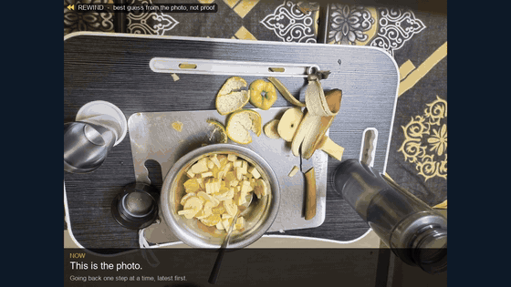
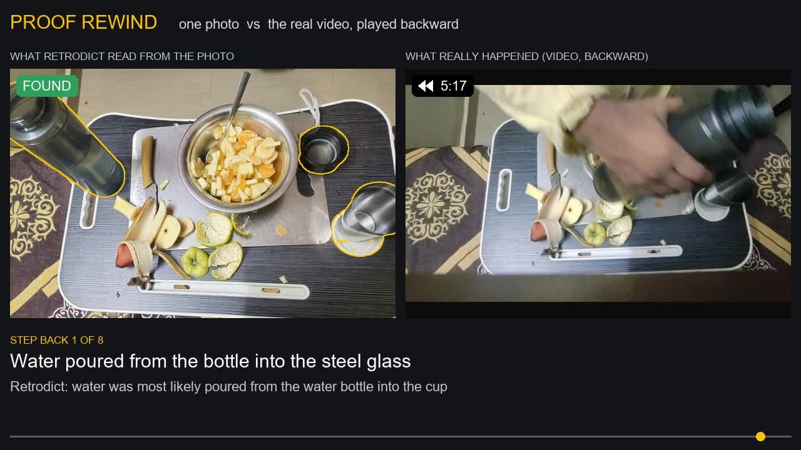
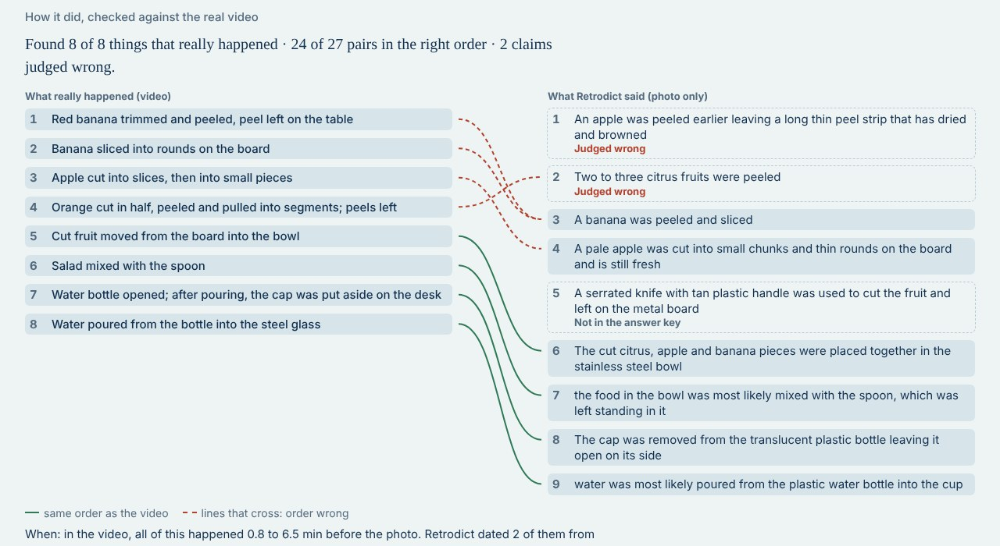
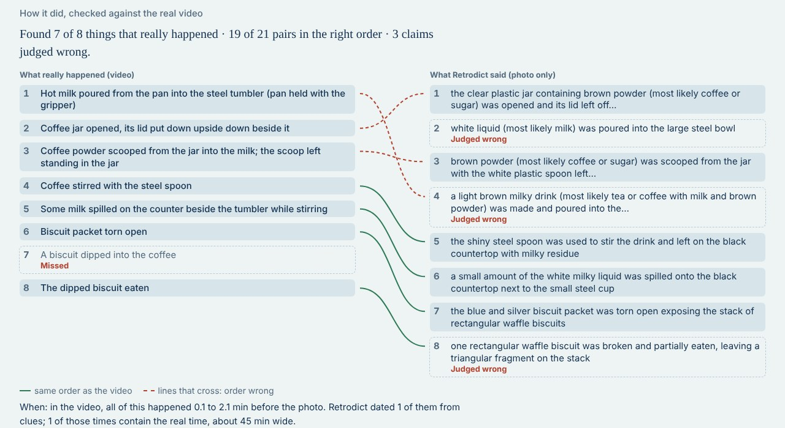
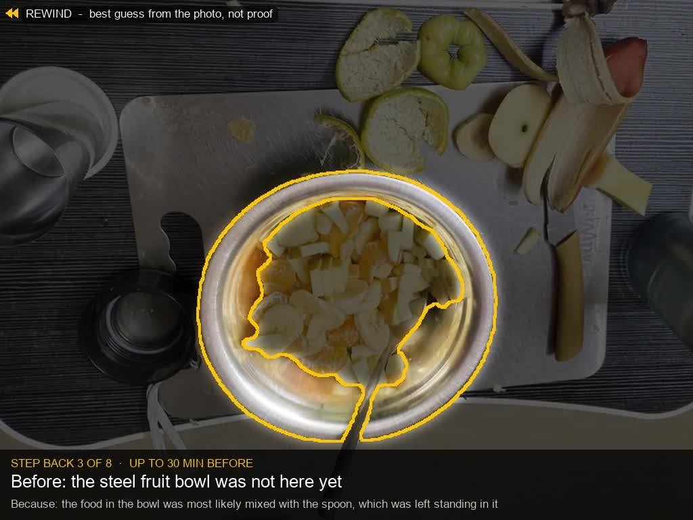

# Retrodict

**From one photo: what most likely happened before it was taken.** Retrodict reads the clues a scene
carries (peels, a lid set aside, a spoon left in a bowl, a lowered drink), proposes what happened, proves
each claim against the photo with outlined evidence, and walks the real photo back step by step.
Then it is checked against a real video of the same scene: on two real kitchen videos it found **8 of 8**
and **7 of 8** events.

## Demo video
[](https://muralikrishnagr.github.io/retrodict/)

**Watch it (2.6 min):** on the [project page](https://muralikrishnagr.github.io/retrodict/), or download
[docs/retrodict_demo.mp4](docs/retrodict_demo.mp4).
**Click through it yourself:** the [live page](https://muralikrishnagr.github.io/retrodict/live/) shows both
real runs, every step and its evidence, in the browser (no install, no key).

| Time | What you see |
|---|---|
| 0:00 | The photo: what happened before it? |
| 0:10 | The web page, live: objects outlined by SAM 3.1, the investigation move by move, the timeline with times from real clues, the evidence for each step (the pour: the bottle open, the cap beside the glass), and the score against the real video |
| 1:01 | The rewind: the real photo walked back, clue by clue |
| 1:28 | Proof rewind: the photo next to the real video, played backward |
| 2:03 | Results, how it works, and where it helps |



Built for the Meta Global AI Developer Hackathon (indie track, Push the Frontier). Every AI model it runs
is a Meta model:

| Model | Job | Where it runs |
|---|---|---|
| **Muse Spark Open** | reads the photo, proposes events, investigates as an agent, checks every claim, judges the scores | any OpenAI-compatible host (Baseten, Modal) |
| **SAM 3.1** | outlines every object; searches inside objects for small clues | local CPU (`transformers`; Meta's weights via the `unsloth/sam3.1` mirror) |
| **V-JEPA 2** | watches the real video as a second witness, for evaluation only | local CPU (`facebook/vjepa2-vitl-fpc16-256-ssv2`) |

The rewind and the proof rewind are drawn with plain image processing (Pillow, OpenCV): the view moves and
dims, the photo itself is never edited, and nothing is generated.

It is a best guess from the photo, not proof, and it says so everywhere.

## Results (two real scenes)
For each scene there is a real video, and a photo taken right after it ended. The answer key (8 real events
per scene, from the video) was written before the runs it scores. A blind judge (Muse Spark Open) decides
which real events each claim describes; its verdicts were checked against the video frames.

| Scene | Real events found | Order | Times | Evidence for each claim |
|---|---|---|---|---|
| Fruit salad (5.5 min video) | **8 of 8** | 24 of 27 pairs | **2 of 2 contain the real time** | **outlined and checked** |
| Coffee and biscuits (75 s video) | **7 of 8** | 19 of 21 pairs | **1 of 1 contains the real time** | **outlined and checked** |

- **Found from what it left:** the water poured into the glass (the bottle open, its cap put down beside the
  glass), the salad mixed (the spoon standing in it), the biscuit eaten (the packet torn open, a drink
  beside it).
- **Careful naming:** a brown powder in a jar is "brown powder, most likely coffee or sugar", which found
  both the jar being opened and the coffee being scooped.
- **Times from real clues:** cut fruit still pale (cut within half an hour) and a spill still wet (within
  45 minutes); both contain the real time, a few minutes before the photo.
- **A second witness:** V-JEPA 2, Meta's video model, watched the salad video and saw 6 of the 8 events it
  has words for.





Reproduce the table from the saved runs with `python scripts/eval_all.py` (free, no model calls).

## How it works
1. **Perceive.** Muse Spark Open names the main objects; SAM 3.1 gives one pixel mask per object.
2. **Propose.** One Muse Spark Open call reads the whole photo and lists what most likely happened, with
   specific names ("the banana was peeled"), and for each claim what in the photo it rests on, described
   by how it looks ("yellow banana peel", "steel tumbler", "black bottle cap").
3. **Gather.** SAM 3.1 searches the photo for every one of those things (local, free). New finds become
   objects; each claim is tied to the objects it rests on before any judging starts.
4. **Read.** Each object, including the new finds, is read on its own from a sharp close-up of the
   original photo, in six views: as photographed, shadows lifted, glare dimmed, and three views of the
   object alone. Physical traces are named here (a pale fresh cut, a browned cut, a cap off), and each
   object gets its specific name ("peel 3" becomes "orange peel").
5. **Prove.** An investigator agent starts with every claim and its evidence, so its few moves go to
   deciding, not hunting: it zooms where a detail decides a claim and drops claims nothing supports.
6. **Second look.** SAM 3.1 looks for common leftovers (a glass, a cap, a cloth); one call sees every
   object the story does not use and works through a checklist of common actions (peeled, cut, poured,
   mixed, opened...), adding a step only where an object shows its trace. Checking each candidate action,
   rather than only what comes to mind, follows work on inferring past actions from one snapshot (Tan et
   al., WACV 2025). Two rules name the action a leftover shows: a spoon standing in mixed food means it was
   mixed; an opened bottle with a cup, and its cap left by the cup or its level dropped, means it was poured.
7. **Verify.** An independent checker sees sharp close-ups and plain claims, never the story, and marks
   each fact confirmed, partly right, can't tell or contradicted. Contradicted events are rejected.
8. **Order and time.** Physical rules fix the order where only one is possible (the same fruit is peeled
   before it is cut, food is cut before it goes into the bowl, mixed after, a bottle is opened before
   pouring). Steps on the same object or food are linked, so a clue that dates one bounds the others.
9. **Rewind.** The real photo, walked back step by step: the view glides to each clue, the rest of the
   scene dims, and a caption says what was there before ("Before: the bottle cap was not here yet"). The photo
   itself is never edited and nothing is generated.



## How times work
Retrodict never guesses a number of minutes. A time comes from **physics**: some things in a scene change
at a known pace after an action, like a clock that started when the action happened.

**1. Physical clocks.** Each clock is a trace you can see and how long it lasts or takes to appear
(minutes before the photo):

| Trace in the photo | What it means | Time |
|---|---|---|
| visible steam above a drink | it was poured or heated only minutes ago | 0 to 10 min |
| ice still whole / partly melted | the ice went in recently / a while ago | 0 to 10 / 5 to 45 min |
| droplets on a cold glass | it was poured not long ago | 0 to 30 min |
| a wet spill or a wet ring | it has not dried yet | 0 to 45 min |
| a dried ring stain | the liquid sat long enough to dry | 30 min to 24 h |
| a skin on milk or tea | it has cooled for a while | 10 to 90 min |
| cut apple or banana still pale | browning has not started: cut recently | 0 to 30 min |
| cut apple or banana gone brown | the flesh has been in the air a while | 15 min to 8 h |

Things like crumbs, an open packet or a lid off show *what* happened but not *when*, so they carry no
clock.

**2. Seen, then confirmed.** The model reading each object names the traces it sees. A clock may date an
event only if the **independent checker**, looking at a sharp close-up, confirms the trace is really
there (bubbles are not a skin, glare is not steam). The cut-fruit clocks apply only to fruit flesh, never
to peels, because the inside of a peel browns within minutes.

**3. Passed along the story.** Steps on the same object or the same food are linked. If the banana slices
are dated "0 to 30 min", the peeling of that banana came before, so it is at least as long ago, and the
step after (the fruit going into the bowl) is at most that long ago. Physical order rules (peel before cut,
cut before into the bowl, open the bottle before pouring) keep that chain in the right order.

**4. No clue, no time.** A step with nothing that dates it says **"time unknown"**, never a guess. On the
page, dated steps are bars on a time ruler (now on the right, the past to the left, with more room for the
last minutes); undated steps are listed in order.

**Example (salad):** the apple and banana pieces in the bowl were still pale and moist, so the checker
confirmed "fresh cut" and the cutting is dated within half an hour. In the video it really was 3.5 to 6
minutes before the photo: inside the range.

## See the output without running anything
Both runs are committed, [`examples/salad_photo/`](examples/salad_photo/) and
[`examples/milk_v2/`](examples/milk_v2/), each with
[`result.json`](examples/salad_photo/result.json) (every event, its evidence, the checker's verdicts and the
times), [`judge.json`](examples/salad_photo/judge.json) and [`score.json`](examples/salad_photo/score.json)
(how it did against the video), [`rewind.mp4`](examples/salad_photo/rewind.mp4),
[`proof_rewind.mp4`](examples/salad_photo/proof_rewind.mp4), `evidence.jpg` (what the checker saw),
`detail_<object>.jpg` (what the model was shown) and `masks/`. To browse them on the web page, with no key and no model calls:
```powershell
python scripts/serve.py --example                  # both finished runs, at http://127.0.0.1:8000
python scripts/export_static.py                    # rebuild the live page in docs/live from examples/
```

## Run it
**No key needed to look:** `python scripts/serve.py --example` (after the install below) opens the finished
salad run on the web page, or use the [live page](https://muralikrishnagr.github.io/retrodict/live/).

**To run it on your own photo** you need Python 3.11+ and a Muse Spark Open endpoint from any
OpenAI-compatible host (Baseten, OpenRouter, Together, Fireworks or Modal). SAM 3.1 runs locally on the CPU.

Windows (PowerShell):
```powershell
python -m venv .venv
.venv\Scripts\activate
pip install -r requirements.txt
copy .env.example .env
python scripts/use_host.py baseten                 # or openrouter, together, fireworks, modal: asks for the key (hidden)
python scripts/check_setup.py                      # one tiny call: is the model reachable?
python -m pytest -q                                # offline tests, no key needed
python scripts/run.py path\to\photo.jpg            # full run (about 5 to 15 min, about 40 US cents)
python scripts/serve.py                            # web page at http://127.0.0.1:8000
```
macOS / Linux: the same, with `source .venv/bin/activate` and `cp .env.example .env`.

The first run downloads SAM 3.1 (~1.7 GB). Results go to `out/<photo name>/`: `result.json`,
`rewind.mp4`, `detail_<object>.jpg` (what the model was shown), `evidence.jpg` (what the checker saw),
`masks/`. On the web page you can upload or take a photo and watch the investigation live; the same photo
is never paid for twice, and photos stay on your computer.

## Evaluate it
```powershell
python scripts/judge.py out\<run> eval\keys\<video>.json      # blind judge (one call)
python scripts/score.py out\<run> eval\keys\<video>.json      # found, order, wrong claims
python scripts/watch_video.py data\videos\<video>.mp4         # V-JEPA 2 watches the real video
python scripts/proof_rewind.py out\<run> eval\keys\<video>.json   # photo vs real video, backward
python scripts/eval_all.py                                    # the results table, every scene, both systems (free)
python scripts/frames.py data\videos\<video>.mp4              # timestamped frames, for writing a new answer key
```
Answer keys live in `eval/keys/` and are committed before the runs they score. Videos and photos stay in
`data/`, which is never committed.

## Cost safety
Every paid call passes a spend guard (`MAX_SPEND_USD`, `MAX_RUN_USD` in `.env`), is cached on disk and is
logged in `.cache/calls.log`. A photo costs about 40 US cents (about 30 calls); SAM 3.1 and V-JEPA 2 run
locally and cost nothing. Re-running the same photo reuses every saved call and costs nothing.
